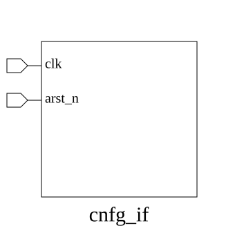

# cnfg_if (interface)

### Source: cnfg_if.sv

## Top IO

## Parameters

|Name|Type|Dimension|Default|Description|
|-|-|-|-|-|
|DRAM_ADDR_BITS|int||14||

## Ports

|Name|Direction|Type|Dimension|Description|
|-|-|-|-|-|
|clk|input|logic|||
|arst_n|input|logic|||

## Description

_No top-level description found._
