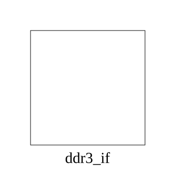

# ddr3_if (interface)

### Source: ddr3_if.sv

## Top IO

## Parameters

|Name|Type|Dimension|Default|Description|
|-|-|-|-|-|
|DRAM_BA_BITS|int||3||
|DRAM_ADDR_BITS|int||14||
|DM_WIDTH|int||8||
|DQS_WIDTH|int||8||
|DATA_WIDTH|int||64||

## Description

_No top-level description found._
