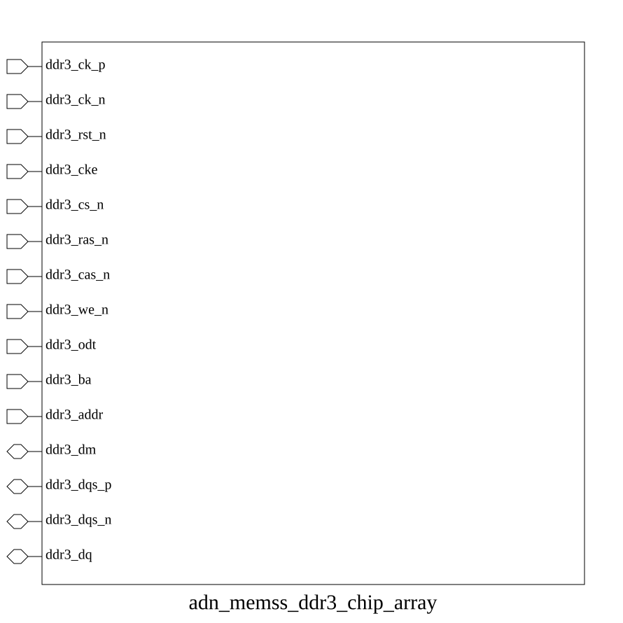

# adn_memss_ddr3_chip_array (module)

### Author: Foez Ahmed (foez.official@gmail.com)

### Source: adn_memss_ddr3_chip_array.sv

## Top IO

## Parameters

|Name|Type|Dimension|Default|Description|
|-|-|-|-|-|
|DATA_WIDTH|int||64||
|DRAM_CHIP_WIDTH|int||16|16 for x16, 8 for x8|
|DRAM_ADDR_BITS|int||16||
|DRAM_BA_BITS|int||3||
|NUM_CHIPS|int||DATA_WIDTH / DRAM_CHIP_WIDTH||
|DQS_WIDTH|int||DATA_WIDTH / 8||
|DM_WIDTH|int||DATA_WIDTH / 8||
|DQS_PER_CHIP|int||DRAM_CHIP_WIDTH / 8||
|DM_PER_CHIP|int||DRAM_CHIP_WIDTH / 8||

## Ports

|Name|Direction|Type|Dimension|Description|
|-|-|-|-|-|
|ddr3_ck_p|input|logic|||
|ddr3_ck_n|input|logic|||
|ddr3_rst_n|input|logic|||
|ddr3_cke|input|logic|||
|ddr3_cs_n|input|logic|||
|ddr3_ras_n|input|logic|||
|ddr3_cas_n|input|logic|||
|ddr3_we_n|input|logic|||
|ddr3_odt|input|logic|||
|ddr3_ba|input|logic [ DRAM_BA_BITS-1:0]|||
|ddr3_addr|input|logic [DRAM_ADDR_BITS-1:0]|||
|ddr3_dm|inout|wire [ DM_WIDTH-1:0]|||
|ddr3_dqs_p|inout|wire [ DQS_WIDTH-1:0]|||
|ddr3_dqs_n|inout|wire [ DQS_WIDTH-1:0]|||
|ddr3_dq|inout|wire [ DATA_WIDTH-1:0]|||

## Description

The `ddr3_chip_array` module `ddr3_chip_array.sv` provides a parameterized structural wrapper that instantiates a parallel array of discrete DDR3 SDRAM components (using Micron's verified `ddr3.v` simulation model).

| REVISION | DATE       | AUTHOR          | DESCRIPTION                                            |
|----------|------------|-----------------|--------------------------------------------------------|
| 0.1      | 2026-11-01 | Foez Ahmed      | Initial version                                        |
| 1.0      | 2026-11-01 | Foez Ahmed      | Stable release                                         |

Author : Foez Ahmed (foez.official@gmail.com)
