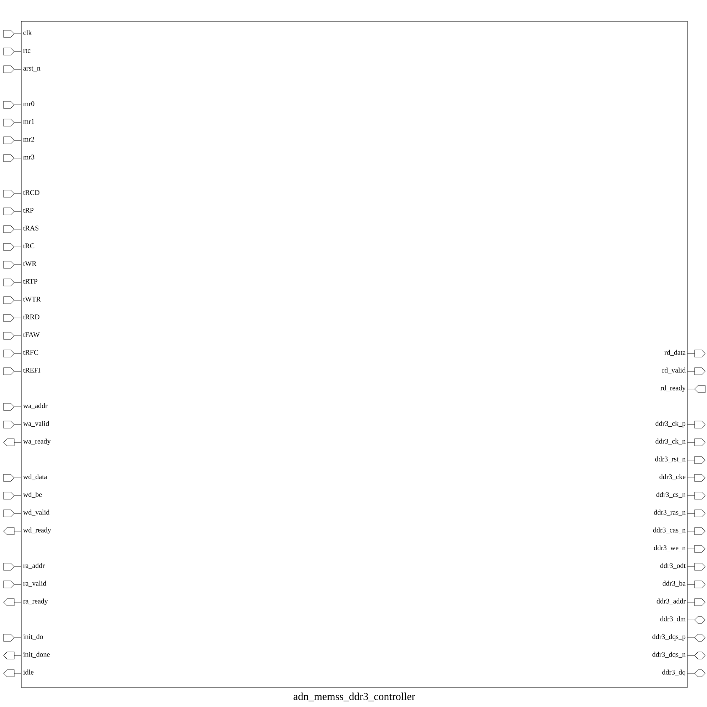

# adn_memss_ddr3_controller (module)

### Author: Foez Ahmed (foez.official@gmail.com)

### Source: adn_memss_ddr3_controller.sv

## Top IO

## Parameters

|Name|Type|Dimension|Default|Description|
|-|-|-|-|-|
|ADDR_WIDTH|int||30|Byte address width|
|DATA_WIDTH|int||64|Datapath width in bits|
|BE_WIDTH|int||DATA_WIDTH / 8|Byte-enable / strobe width|
|BURST_LEN|int||8|Fixed 8 beats per mem_if transaction|
|ACCESS_SIZE_BYTES|int||DATA_WIDTH|Block size in bytes = DATA_WIDTH|
|ALIGN_SHIFT|int||$clog2(DATA_WIDTH)|LSBs forced to 0 for alignment|
|DRAM_CHIP_WIDTH|int||16|DQ bits per chip: 16 (for x16) or 8 (for x8)|
|NUM_CHIPS|int||DATA_WIDTH / DRAM_CHIP_WIDTH|Number of parallel chips (2^n)|
|DQS_WIDTH|int||DATA_WIDTH / 8|1 differential DQS pair per byte lane|
|DM_WIDTH|int||DATA_WIDTH / 8|1 Data Mask bit per byte lane|
|DRAM_ADDR_BITS|int||16|DDR3 A[15:0] pin width|
|DRAM_BA_BITS|int||3|DDR3 BA[2:0] pin width (8 banks)|
|DRAM_ROW_BITS|int||16|Row address width|
|DRAM_COL_BITS|int||10|Column address width (10 for x16, 11 for x8)|
|SIM_SPEED_UP|bit||1'b1|Accelerates power-up delays for simulation|

## Ports

|Name|Direction|Type|Dimension|Description|
|-|-|-|-|-|
|clk|input|logic|||
|rtc|input|logic|||
|arst_n|input|logic||Asynchronous active-low reset|
|mr0|input|logic [DRAM_ADDR_BITS-1:0]|||
|mr1|input|logic [DRAM_ADDR_BITS-1:0]|||
|mr2|input|logic [DRAM_ADDR_BITS-1:0]|||
|mr3|input|logic [DRAM_ADDR_BITS-1:0]|||
|tRCD|input|logic [15:0]||ACT to READ/WRITE delay (in RTC ticks)|
|tRP|input|logic [15:0]||PRECHARGE command period (in RTC ticks)|
|tRAS|input|logic [15:0]||ACT to PRECHARGE delay (in RTC ticks)|
|tRC|input|logic [15:0]||ACT to ACT / REF period (in RTC ticks)|
|tWR|input|logic [15:0]||Write recovery time (in RTC ticks)|
|tRTP|input|logic [15:0]||READ to PRECHARGE delay (in RTC ticks)|
|tWTR|input|logic [15:0]||Write to Read delay (in RTC ticks)|
|tRRD|input|logic [15:0]||ACT bank A to ACT bank B delay (in RTC ticks)|
|tFAW|input|logic [15:0]||Four-bank activate window (in RTC ticks)|
|tRFC|input|logic [15:0]||AUTO REFRESH command period (in RTC ticks)|
|tREFI|input|logic [15:0]||Periodic refresh interval (~7.8 us in RTC ticks)|
|wa_addr|input|logic [ADDR_WIDTH-1:0]||Write address|
|wa_valid|input|logic||Write address valid signal|
|wa_ready|output|logic||Write address ready signal|
|wd_data|input|logic [DATA_WIDTH-1:0]||Write data|
|wd_be|input|logic [ BE_WIDTH-1:0]||Write byte enable|
|wd_valid|input|logic||Write data valid signal|
|wd_ready|output|logic||Write data ready signal|
|ra_addr|input|logic [ADDR_WIDTH-1:0]||Read address|
|ra_valid|input|logic||Read address valid signal|
|ra_ready|output|logic||Read address ready signal|
|rd_data|output|logic [DATA_WIDTH-1:0]||Read data|
|rd_valid|output|logic||Read data valid signal|
|rd_ready|input|logic||Read data ready signal|
|ddr3_ck_p|output|logic|||
|ddr3_ck_n|output|logic|||
|ddr3_rst_n|output|logic||DDR3 active-low reset|
|ddr3_cke|output|logic||DDR3 clock enable|
|ddr3_cs_n|output|logic||DDR3 chip select|
|ddr3_ras_n|output|logic||DDR3 row address strobe|
|ddr3_cas_n|output|logic||DDR3 column address strobe|
|ddr3_we_n|output|logic||DDR3 write enable|
|ddr3_odt|output|logic||DDR3 on-die termination|
|ddr3_ba|output|logic [ DRAM_BA_BITS-1:0]||DDR3 bank address|
|ddr3_addr|output|logic [DRAM_ADDR_BITS-1:0]||DDR3 address bus|
|ddr3_dm|inout|wire [ DM_WIDTH-1:0]||DDR3 data mask (active high)|
|ddr3_dqs_p|inout|wire [ DQS_WIDTH-1:0]||DDR3 data strobe +|
|ddr3_dqs_n|inout|wire [ DQS_WIDTH-1:0]||DDR3 data strobe -|
|ddr3_dq|inout|wire [DATA_WIDTH-1:0]||DDR3 bidirectional data bus|
|init_do|input|logic||Request (re-)initialization; held high until init_done goes low|
|init_done|output|logic||High when initialization complete|
|idle|output|logic|||

## Description

# adn_memss_ddr3_controller

Fully Functional Fixed-Burst (mem_if) DDR3 SDRAM Controller

## Key Features:
- **Decoupled Fixed-Burst Host Interface (`mem_if`)**: Operates on a fixed transaction granularity of 8 beats ($BL = 8$) over independent Write Address, Write Data, Read Address, and Read Data channels with full Ready/Valid backpressure flow control.
- **Closed-Page Policy with Autonomous Precharge**: Employs a closed-page memory management strategy with hardware Auto-Precharge ($A[10] = 1$). Every activate command is immediately followed by a read or write with auto-precharge, eliminating bank conflict stalls and complex row tracking logic.
- **Idle Clock Throttling & Internal 2:1 Clock Generation**: Accepts a system clock (`clk`, $F_{sys} = 2 \times F_{ddr}$) that can dynamically throttle or slow down during idle periods, and synthesizes differential DDR3 clocks (`ddr3_ck_p` / `ddr3_ck_n`) internally at `clk / 2`. Registering on alternating clock edges guarantees 1 full system clock cycle ($T_{sys} = 0.5\,t_{CK}$) of command setup time prior to the DRAM latching edge across any clock frequency.
- **Real-Time Clock (`rtc`) Timing Engine**: Uses an independent Real-Time Clock (`rtc`) input—ranging from slow $1\text{ MHz}$, $8\text{ MHz}$, $16\text{ MHz}$, $32\text{ MHz}$ up to $100\text{ MHz}$ max—to measure all wall-clock JEDEC timing intervals ($t_{RCD}$, $t_{RP}$, $t_{RAS}$, $t_{RC}$, $t_{WR}$, $t_{RTP}$, $t_{WTR}$, $t_{RRD}$, $t_{FAW}$, $t_{RFC}$, $t_{REFI}$, and power-up reset delays) invariants of `clk` throttling.
- **Runtime Register File Configuration & Mode Register Decoding**: All Mode Registers (`mr0`–`mr3`) and JEDEC timing parameters (in RTC ticks) are provided as runtime input ports from an external register file. The controller combinationally decodes `CL`, `CWL`, `AL`, `WR` ($t_{CK}$), `RL`, and `WL` directly from `mr0`, `mr1`, and `mr2`.
- **Standard JEDEC Power-Up and Mode Register Synthesis**: Executes the complete JEDEC DDR3 initialization protocol upon reset release: stable power-up delay ($200\,\mu\text{s}$), active-low reset exit ($500\,\mu\text{s}$), CKE assertion ($t_{XPR}$), mode register initialization ($MR2 \rightarrow MR3 \rightarrow MR1 \rightarrow MR0$ with DLL reset), ZQ Calibration Long ($ZQCL$), and DLL lock wait.
- **Autonomous Periodic Auto-Refresh Engine**: Built-in RTC-driven $t_{REFI}$ timer with up to 8 accumulated refresh credits. Automatically arbitrates and issues highest-priority `CMD_REFRESH` ($t_{RFC}$) bursts without host intervention, preventing DRAM data retention failure even when `clk` is throttled during idle.
- **Synthesizable Write PHY with Center-Aligned Strobe Synthesis**: Generates clean differential DQS write strobes with JEDEC-compliant preamble and postamble. DQ and DM are launched on the negative edge of `clk`, providing an exact $90^\circ$ phase lead ($325\text{ ps}$ at $1.54\text{ GHz}$) that centers write data eyes precisely on the DQS transitions without expensive analog delay-locked loops (DLLs).
- **Asynchronous Read Capture PHY & Dual-Edge Gearbox**: Features a dual-edge DQS-strobed capture memory with simulated analog eye centering (`#250ps`), preamble falling-edge glitch suppression, and a synchronous gearbox that transfers captured 8-beat bursts into the read FIFO across the system clock domain.

| REVISION | DATE       | AUTHOR          | DESCRIPTION                                            |
|----------|------------|-----------------|--------------------------------------------------------|
| 0.1      | 2026-11-01 | Foez Ahmed      | Initial version                                        |
| 1.0      | 2026-11-01 | Foez Ahmed      | Stable release                                         |

Author : Foez Ahmed (foez.official@gmail.com)
