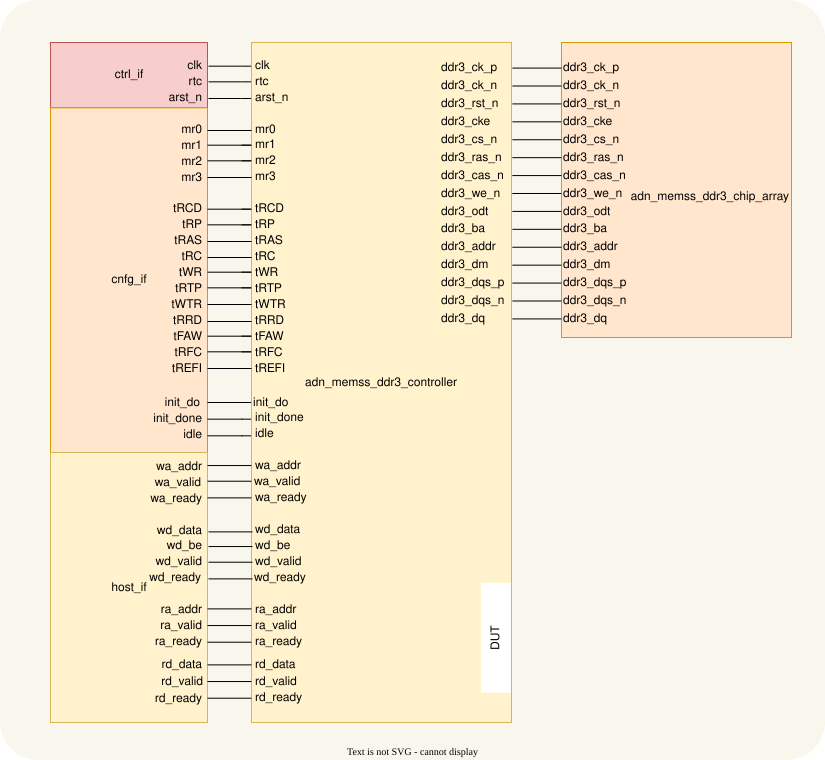
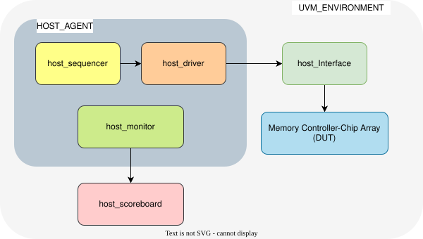

# DDR3 Memory Controller UVM Testbench

**Target DUT:** `adn_memss_ddr3_controller`  
**Methodology:** SystemVerilog / UVM  
**Verification Interfaces:** `ctrl_if`, `host_if`, and `cfg_if`  
**Verification Agents:** Active `host_agent` only (No passive `ddr3_monitor` agent; protocol observation and timing checks are handled directly by the Micron DRAM Memory Model).

Related module documentation: [adn_memss_ddr3_controller](adn_memss_ddr3_controller.md) · [adn_memss_ddr3_chip_array](adn_memss_ddr3_chip_array.md)

---

## 1. Overview & Architecture Scope

This document outlines the Universal Verification Methodology (UVM) plan for the `adn_memss_ddr3_controller`. The verification environment utilizes an active `host_agent` to drive stimulus across the host interfaces, while the Micron DDR3 memory model acts as the physical responder, validating protocol compliance and timing constraints automatically.

---

## Top IO

The testbench connects to the controller's host, configuration, clock/reset, status, and DDR3 physical ports. The host and configuration interfaces below are testbench abstractions; the DUT itself exposes individual ports as listed in [adn_memss_ddr3_controller.md](adn_memss_ddr3_controller.md).

## Parameters

The UVM testbench uses the following default DUT configuration.

| Name | Type | Default | Description |
|---|---|---|---|
| `ADDR_WIDTH` | `int` | `30` | Byte address width. |
| `DATA_WIDTH` | `int` | `64` | Data width per host transfer in bits. |
| `BURST_LEN` | `int` | `8` | Fixed number of transfers per block transaction. |
| `DRAM_CHIP_WIDTH` | `int` | `16` | Data width of each modeled DDR3 chip. |
| `SIM_SPEED_UP` | `bit` | `1'b1` | Enables accelerated power-up delays for simulation. |

## Ports

| Name | Direction | Type | Dimension | Description |
|---|---|---|---|---|
| `clk` | input | `logic` | — | System clock. |
| `rtc` | input | `logic` | — | Real-time clock used for DDR3 timing intervals. |
| `arst_n` | input | `logic` | — | Asynchronous active-low reset. |
| `mr0`–`mr3` | input | `logic` | `[DRAM_ADDR_BITS-1:0]` each | DDR3 Mode Register values. |
| `tRCD`, `tRP`, `tRAS`, `tRC`, `tWR`, `tRTP`, `tWTR`, `tRRD`, `tFAW`, `tRFC`, `tREFI` | input | `logic` | `[15:0]` each | DDR3 timing parameters in `rtc` ticks. |
| `wa_addr` | input | `logic` | `[ADDR_WIDTH-1:0]` | Write address. |
| `wa_valid` | input | `logic` | — | Write address valid. |
| `wa_ready` | output | `logic` | — | Write address ready. |
| `wd_data` | input | `logic` | `[DATA_WIDTH-1:0]` | Write data beat. |
| `wd_be` | input | `logic` | `[DATA_WIDTH/8-1:0]` | Write byte enables. |
| `wd_valid` | input | `logic` | — | Write data valid. |
| `wd_ready` | output | `logic` | — | Write data ready. |
| `ra_addr` | input | `logic` | `[ADDR_WIDTH-1:0]` | Read address. |
| `ra_valid` | input | `logic` | — | Read address valid. |
| `ra_ready` | output | `logic` | — | Read address ready. |
| `rd_data` | output | `logic` | `[DATA_WIDTH-1:0]` | Read data beat. |
| `rd_valid` | output | `logic` | — | Read data valid. |
| `rd_ready` | input | `logic` | — | Read data ready. |
| `ddr3_ck_p`, `ddr3_ck_n` | output | `logic` | scalar each | DDR3 differential clock. |
| `ddr3_rst_n`, `ddr3_cke`, `ddr3_cs_n`, `ddr3_ras_n`, `ddr3_cas_n`, `ddr3_we_n`, `ddr3_odt` | output | `logic` | scalar each | DDR3 reset, enable, command, and termination signals. |
| `ddr3_ba` | output | `logic` | `[DRAM_BA_BITS-1:0]` | DDR3 bank address. |
| `ddr3_addr` | output | `logic` | `[DRAM_ADDR_BITS-1:0]` | DDR3 address bus. |
| `ddr3_dm` | inout | `wire` | `[DATA_WIDTH/8-1:0]` | DDR3 data mask. |
| `ddr3_dqs_p`, `ddr3_dqs_n` | inout | `wire` | `[DATA_WIDTH/8-1:0]` each | DDR3 differential data strobes. |
| `ddr3_dq` | inout | `wire` | `[DATA_WIDTH-1:0]` | DDR3 bidirectional data bus. |
| `init_do` | input | `logic` | — | Re-initialization request. |
| `init_done` | output | `logic` | — | Initialization complete status. |
| `idle` | output | `logic` | — | Controller idle status. |

With the defaults above, each block transaction contains 512 data bits. Byte-enable width is `DATA_WIDTH/8` (8 bits at the default width). The physical DDR3 ports connect to the chip array described in [adn_memss_ddr3_chip_array.md](adn_memss_ddr3_chip_array.md).

---

## Test Environment

The planned environment uses an active host agent, a configuration driver, a scoreboard/reference memory, protocol checking, and the Micron DDR3 model connected through the chip-array wrapper. The diagram will show their connections and transaction flow.

---

## 2. Comprehensive Test Suite & Test Cases

### 2.1 DDR3 Initialization Test
* **Objective:** Verify that the memory controller correctly executes the JEDEC initialization sequence, programs Mode Registers (`MR0`–`MR3`), performs ZQ calibration, and asserts `init_done` via the configuration interface.
* **Stimulus:** Release hardware reset, invoke `cfg_if.apply_cfg()`, and monitor the initialization process without issuing any host transactions.
* **Expected Result:** The `init_done` signal asserts high within the expected cycle count. The Micron DRAM model successfully captures the MRS command sequence (`MR2 -> MR3 -> MR1 -> MR0 -> ZQCL`) with zero protocol or timing violations.

---

### 2.2 Single Write and Read Test
* **Objective:** Verify the basic end-to-end data path for a single 512-bit block transaction (8-beat burst write followed by a read) through the host and physical interfaces.
* **Stimulus:** Issue one Write command with an 8-beat data payload (`wd_be = 8'hFF`) to a targeted aligned address, followed immediately by a Read request to the same address.
* **Expected Result:** The Scoreboard successfully correlates the read data returned via `host_if` with the golden memory reference and confirms a 100% data match with zero errors.

---

### 2.3 Masking Test (Byte-Enable Masking)
* **Objective:** Verify partial block writes using byte-enable (`wd_be`) patterns mapped through the controller to the physical DRAM Data Mask (`ddr3_dm`) pins.
* **Stimulus:** Write a baseline pattern to an address, then overwrite it using various partial byte masks (`8'hAA`, `8'h55`, `8'h0F`, `8'h00`, etc.). Finally, issue a Read request to verify the stored data.
* **Expected Result:** The Scoreboard byte-masking logic confirms that only the enabled bytes (`be[i] == 1`) are updated in memory, while masked bytes (`be[i] == 0`) retain their previous baseline values.

---

### 2.4 Burst Test (Back-to-Back Bursts)
* **Objective:** Verify zero-bubble back-to-back transaction handling and scheduling performance across the host and physical buses.
* **Stimulus:** Send multiple consecutive Write transactions (e.g., 16 bursts) followed immediately by consecutive Read transactions with zero inter-transaction delay.
* **Expected Result:** The controller manages traffic seamlessly without data loss, and all read data matches the golden reference.

---

### 2.5 Write Backpressure Test
* **Objective:** Verify controller flow control when write demands exceed processing capacity.
* **Stimulus:** Flood the host write channels continuously to saturate internal controller queues faster than the DRAM can drain them.
* **Expected Result:** The controller cleanly de-asserts `wa_ready` and `wd_ready` on `host_if` to stall the host driver, preventing data loss until space clears.

---

### 2.6 Read Backpressure Test
* **Objective:** Verify read data buffering and flow control when the host is unable to accept incoming read data.
* **Stimulus:** Issue multiple Read requests, then intentionally de-assert `host_if.rd_ready = 1'b0` from the driver side while the controller attempts to return read data.
* **Expected Result:** The controller holds returning read data safely inside its internal storage and delivers it intact once `rd_ready` re-asserts.

---

### 2.7 Random Read-Write Stress Test
* **Objective:** Validate overall controller stability and data integrity under heavy, randomized traffic conditions.
* **Stimulus:** Execute a large volume (e.g., 1,000+ transactions) of randomized read/write mixes, random addresses, random byte masks, and decoupled channel delays.
* **Expected Result:** Zero Scoreboard mismatches, all internal tracking queues empty properly at the end of the simulation, and zero violations reported by the Micron DRAM model.

---

### 2.8 Refresh Collision Test
* **Objective:** Verify that periodic DRAM refresh (`tREFI`) cycles are arbitrated correctly without stalling or corrupting active host traffic.
* **Stimulus:** Run continuous Read/Write traffic while configuring a shorter `tREFI` interval so that refresh requests collide frequently with active transaction bursts.
* **Expected Result:** The controller finishes ongoing bursts safely, inserts the `REF` command without violating timing constraints, and resumes host traffic smoothly without data loss or model errors.

---

### 2.9 On-The-Fly Configuration Change Test
* **Objective:** Verify dynamic timing updates and mid-traffic re-initialization (`init_do` assertion during active operation) without causing deadlocks, protocol violations, or data corruption.
* **Stimulus:** 
  1. Initialize the controller with baseline timing parameters and run continuous Read/Write traffic.
  2. Dynamically update timing counters (such as `tRP`, `tRCD`, and `tREFI`) on the fly via `cfg_if` without asserting reset or re-init.
  3. Pulse `init_do = 1'b1` mid-traffic to trigger live mode-register updates (`MR0`–`MR3`) while host transactions are active.
* **Expected Result:** The controller cleanly throttles `wa_ready`/`ra_ready` during re-initialization, applies the new timing parameters on the fly without violating Micron model constraints, and ensures 100% data match in the Scoreboard across all phases.

---

