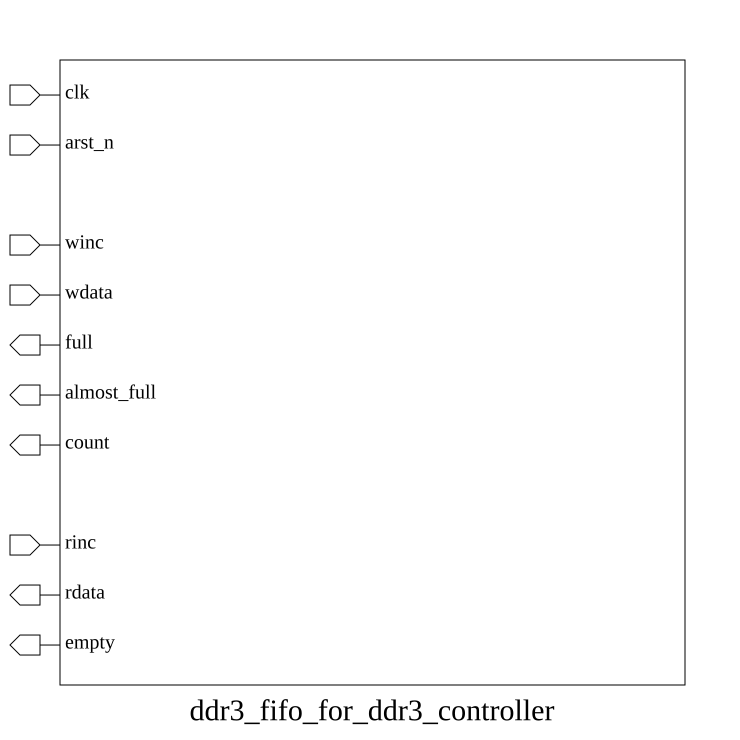

# ddr3_fifo_for_ddr3_controller (module)

### Source: ddr3_fifo_for_ddr3_controller.sv

## Top IO

## Parameters

|Name|Type|Dimension|Default|Description|
|-|-|-|-|-|
|NAME|string||""||
|WIDTH|int||64||
|DEPTH|int||16||

## Ports

|Name|Direction|Type|Dimension|Description|
|-|-|-|-|-|
|clk|input|logic|||
|arst_n|input|logic|||
|winc|input|logic||Write Port|
|wdata|input|logic [ WIDTH-1:0]|||
|full|output|logic|||
|almost_full|output|logic|||
|count|output|logic [$clog2(DEPTH):0]|||
|rinc|input|logic||Read Port|
|rdata|output|logic [WIDTH-1:0]|||
|empty|output|logic|||

## Description

_No top-level description found._
