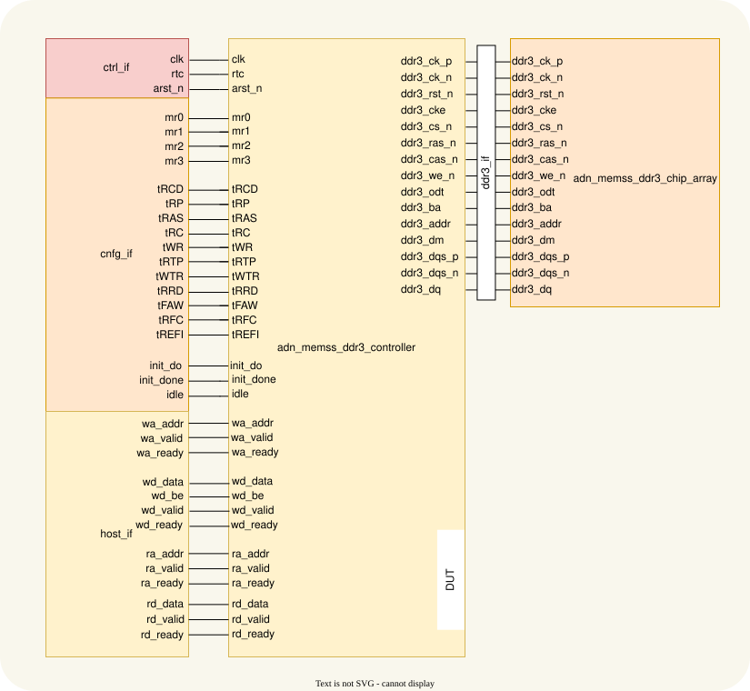
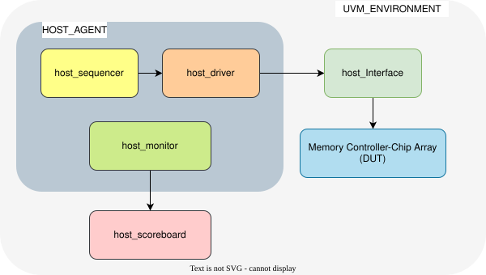

# DDR3 Memory Controller UVM Testbench

**Target DUT:** `adn_memss_ddr3_controller`  
**Methodology:** SystemVerilog / UVM  
**Verification Interfaces:** `ctrl_if`, `host_if`, and `cfg_if`  
**Verification Agents:** Active `host_agent` only (No passive `ddr3_monitor` agent; protocol observation and timing checks are handled directly by the Micron DRAM Memory Model).

Related module documentation: [adn_memss_ddr3_controller](adn_memss_ddr3_controller.md) · [adn_memss_ddr3_chip_array](adn_memss_ddr3_chip_array.md)

---

## 1. Overview & Architecture Scope

This document outlines the Universal Verification Methodology (UVM) plan for the `adn_memss_ddr3_controller`. The verification environment utilizes an active `host_agent` to drive stimulus across the host interfaces, while the Micron DDR3 memory model acts as the physical responder, validating protocol compliance and timing constraints automatically.

---

## Top IO

The testbench connects to the controller's host, configuration, clock/reset, status, and DDR3 physical ports. The host and configuration interfaces below are testbench abstractions; the DUT itself exposes individual ports as listed in [adn_memss_ddr3_controller.md](adn_memss_ddr3_controller.md).

## Parameters

The UVM testbench uses the following default DUT configuration.

| Name | Type | Default | Description |
|---|---|---|---|
| `ADDR_WIDTH` | `int` | `30` | Byte address width. |
| `DATA_WIDTH` | `int` | `64` | Data width per host transfer in bits. |
| `BURST_LEN` | `int` | `8` | Fixed number of transfers per block transaction. |
| `DRAM_CHIP_WIDTH` | `int` | `16` | Data width of each modeled DDR3 chip. |
| `SIM_SPEED_UP` | `bit` | `1'b1` | Enables accelerated power-up delays for simulation. |

## Ports

| Name | Direction | Type | Dimension | Description |
|---|---|---|---|---|
| `clk` | input | `logic` | — | System clock. |
| `rtc` | input | `logic` | — | Real-time clock used for DDR3 timing intervals. |
| `arst_n` | input | `logic` | — | Asynchronous active-low reset. |
| `mr0`–`mr3` | input | `logic` | `[DRAM_ADDR_BITS-1:0]` each | DDR3 Mode Register values. |
| `tRCD`, `tRP`, `tRAS`, `tRC`, `tWR`, `tRTP`, `tWTR`, `tRRD`, `tFAW`, `tRFC`, `tREFI` | input | `logic` | `[15:0]` each | DDR3 timing parameters in `rtc` ticks. |
| `wa_addr` | input | `logic` | `[ADDR_WIDTH-1:0]` | Write address. |
| `wa_valid` | input | `logic` | — | Write address valid. |
| `wa_ready` | output | `logic` | — | Write address ready. |
| `wd_data` | input | `logic` | `[DATA_WIDTH-1:0]` | Write data beat. |
| `wd_be` | input | `logic` | `[DATA_WIDTH/8-1:0]` | Write byte enables. |
| `wd_valid` | input | `logic` | — | Write data valid. |
| `wd_ready` | output | `logic` | — | Write data ready. |
| `ra_addr` | input | `logic` | `[ADDR_WIDTH-1:0]` | Read address. |
| `ra_valid` | input | `logic` | — | Read address valid. |
| `ra_ready` | output | `logic` | — | Read address ready. |
| `rd_data` | output | `logic` | `[DATA_WIDTH-1:0]` | Read data beat. |
| `rd_valid` | output | `logic` | — | Read data valid. |
| `rd_ready` | input | `logic` | — | Read data ready. |
| `ddr3_ck_p`, `ddr3_ck_n` | output | `logic` | scalar each | DDR3 differential clock. |
| `ddr3_rst_n`, `ddr3_cke`, `ddr3_cs_n`, `ddr3_ras_n`, `ddr3_cas_n`, `ddr3_we_n`, `ddr3_odt` | output | `logic` | scalar each | DDR3 reset, enable, command, and termination signals. |
| `ddr3_ba` | output | `logic` | `[DRAM_BA_BITS-1:0]` | DDR3 bank address. |
| `ddr3_addr` | output | `logic` | `[DRAM_ADDR_BITS-1:0]` | DDR3 address bus. |
| `ddr3_dm` | inout | `wire` | `[DATA_WIDTH/8-1:0]` | DDR3 data mask. |
| `ddr3_dqs_p`, `ddr3_dqs_n` | inout | `wire` | `[DATA_WIDTH/8-1:0]` each | DDR3 differential data strobes. |
| `ddr3_dq` | inout | `wire` | `[DATA_WIDTH-1:0]` | DDR3 bidirectional data bus. |
| `init_do` | input | `logic` | — | Re-initialization request. |
| `init_done` | output | `logic` | — | Initialization complete status. |
| `idle` | output | `logic` | — | Controller idle status. |

With the defaults above, each block transaction contains 512 data bits. Byte-enable width is `DATA_WIDTH/8` (8 bits at the default width). The physical DDR3 ports connect to the chip array described in [adn_memss_ddr3_chip_array.md](adn_memss_ddr3_chip_array.md).

---

## Test Environment

The planned environment uses an active host agent, a configuration driver, a scoreboard/reference memory, protocol checking, and the Micron DDR3 model connected through the chip-array wrapper. The diagram will show their connections and transaction flow.

---

## 2. Comprehensive Test Suite & Test Cases

### 2.1 DDR3 Reset Test
 
**Objective:** Verify that asserting `arst_n`, at power-up and during active operation, drives the controller and DDR3 interface to a safe, known state, and that no stale state survives into the next initialization.
 
**Preconditions:** Clocks (`clk`, `rtc`) are running and stable. Default parameters with `SIM_SPEED_UP = 1`. The host driver holds all `valid` signals low.
 
| Step | Action | Check |
|---|---|---|
| 1 | Hold `arst_n = 0` from time zero for N cycles (run with N = 2, 5, 20). | `init_done`, `idle`, `ddr3_rst_n`, `ddr3_cke`, `ddr3_cs_n`, `wa_ready`, `wd_ready`, `ra_ready`, and `rd_valid` hold their reset values on every `clk` edge while reset is low. |
| 2 | Wait one extra `rtc` period with reset still low. | `ddr3_cs_n` stays inactive; no DDR3 command is issued. |
| 3 | Release `arst_n`. Do not call `cfg_if.apply_cfg()`. | Outputs stay at their reset values. |
| 4 | Wait a fixed window (e.g., 5,000 `clk` cycles). | `init_done` stays 0; `ddr3_cke` stays 0; no MRS or other command appears on the DDR3 pins; `wa_ready`, `wd_ready`, `ra_ready` stay 0. |
| 5 | Call `cfg_if.apply_cfg()` and wait for `init_done`. | `init_done` asserts within `INIT_TIMEOUT_CYCLES`. |
| 6 | Start `host_rand_traffic_seq` (mixed reads and writes, 20+ transactions queued). | Scoreboard tracks normally. |
| 7 | At a randomized point in the traffic, assert `arst_n = 0` asynchronously, not aligned to `clk`. | Outputs hold their reset values from the next `clk` edge. |
| 8 | Kill any pending host sequences. Hold reset for N cycles, then release. | No `ready` or `rd_valid` activity while reset is low. |
| 9 | Flush the scoreboard: clear the pending-write queue, pending-read queue, and reference memory. | Queues empty; reference memory holds no data. |
| 10 | Call `cfg_if.apply_cfg()` and wait for `init_done`. | `init_done` asserts within `INIT_TIMEOUT_CYCLES`; the full MRS sequence is seen again. |
| 11 | Issue 8 writes, then 8 reads, to fresh random aligned addresses. | Scoreboard reports a 100% match. |
| 12 | Repeat steps 5–11 with a different random reset point each time (e.g., 20 iterations). | All checks hold on every iteration. |
| 13 | End-of-test checks. | Scoreboard queues empty; zero Micron model errors. |
 
**Expected result:** Every check passes on every iteration; zero scoreboard mismatches after recovery; zero Micron model errors.
 
---
 
### 2.2 DDR3 Initialization Test
 
**Objective:** Verify that the controller executes the JEDEC initialization sequence, programs Mode Registers (`MR0`–`MR3`) with the values supplied on `mr0`–`mr3`, performs ZQ calibration, and asserts `init_done`, without any host transactions.
 
**Preconditions:** Reset has been applied and released (see 2.1). Clocks are stable. No host traffic is driven. Run 1 uses the baseline `mr0`–`mr3` and timing values; Run 2 uses an alternate valid MR set (different CL/CWL); optional Run 3 uses `SIM_SPEED_UP = 0`.
 
| Step | Action | Check |
|---|---|---|
| 1 | Drive the config object onto `mr0`–`mr3` and the timing ports. Call `cfg_if.apply_cfg()`. | The configuration stays stable until `init_done`. |
| 2 | Monitor `ddr3_rst_n` and `ddr3_cke`. | `ddr3_rst_n` releases first, then `ddr3_cke` asserts, as required by the JEDEC power-up sequence and the model. |
| 3 | Monitor the DDR3 command pins while `init_done = 0`. | No `ACT`, `READ`, `WRITE`, or `REF` commands. |
| 4 | Observe the MRS commands (`cs_n=0, ras_n=0, cas_n=0, we_n=0`). | Four MRS commands appear in the order MR2, MR3, MR1, MR0, identified by `ddr3_ba` = 2, 3, 1, 0. |
| 5 | Compare `ddr3_addr` on each MRS command. | Each value equals the matching `mr2`, `mr3`, `mr1`, `mr0` input. |
| 6 | Observe the ZQ calibration command (`cs_n=0, ras_n=1, cas_n=1, we_n=0`, `A10 = 1`). | One `ZQCL` appears after the MR0 command. |
| 7 | Check spacing between commands. | No command is issued earlier than the minimum spacing the Micron model enforces (tMRD, tMOD, tZQinit); zero model violations. |
| 8 | Wait for `init_done`. | `init_done` rises within `INIT_TIMEOUT_CYCLES` (from the controller spec, scaled for `SIM_SPEED_UP`) and stays high. |
| 9 | Sample `idle`, `wa_ready`, `ra_ready` after `init_done`. | `idle` is high and the host ready signals are in their ready state, as defined by the spec. |
| 10 | Leave the host idle for a window (e.g., 2,000 `clk` cycles). | Only legal commands appear (refresh, if due); no model violations. |
| 11 | Repeat from reset with Run 2 (alternate MR set). | Steps 2–10 hold with the new MR values. |
 
**Expected result:** All steps pass in every run; `init_done` asserts within the timeout; MRS order and values are correct; `ZQCL` is present; zero Micron model violations.
 
---
 
### 2.3 Single Write and Read Test
 
**Objective:** Verify the basic end-to-end data path for a single 512-bit block transaction (8 beats × 64 bits) written and read back through the host and physical interfaces.
 
**Preconditions:** Reset and initialization are complete (`init_done = 1`, `idle = 1`). The scoreboard reference memory is empty. Test addresses are aligned to the 64-byte block size (low 6 address bits = 0).
 
| Step | Action | Check |
|---|---|---|
| 1 | Wait for `init_done`. | `idle = 1`. |
| 2 | Pick an aligned address `A` and a data pattern. | `A[5:0] = 0`. |
| 3 | Drive the write address: `wa_addr = A`, `wa_valid = 1` until `wa_ready`. | Handshake completes within the timeout; the scoreboard records a pending write at `A`. |
| 4 | Drive 8 write data beats on `wd_data` with `wd_be = 8'hFF` on every beat, `wd_valid = 1` until `wd_ready` for each beat. | Exactly 8 `wd` handshakes are accepted; `wd_valid` and the payload stay stable until accepted. |
| 5 | When the last write data beat is accepted, immediately drive the read address: `ra_addr = A`, `ra_valid = 1` until `ra_ready`. | Read handshake completes within the timeout. |
| 6 | Hold `rd_ready = 1`. Collect read data. | Exactly 8 beats with `rd_valid = 1` are returned, with no extra beats. |
| 7 | Scoreboard compares the 8 beats, in order, against the reference memory at `A`. | All 8 beats match. |
| 8 | Wait for the controller to drain. | `idle` returns high within the timeout; no unexpected `rd_valid` or DDR3 activity afterwards. |
| 9 | Repeat steps 2–8 with low, mid, and high addresses, one address per DRAM bank, two rows of the same bank, and random addresses, using incrementing, all-zeros, all-ones, checkerboard, walking-one, and random data patterns. | All checks hold for every combination. |
| 10 | End-of-test checks. | Scoreboard queues empty; zero Micron model violations. |
 
**Expected result:** Every combination passes steps 2–8; zero scoreboard mismatches; zero Micron model errors; no timeouts.
 
---
 
### 2.4 Byte-Enable Masking Test
 
**Objective:** Verify partial block writes using `wd_be` patterns mapped through the controller to the DRAM data mask (`ddr3_dm`) pins.
 
**Preconditions:** Reset and initialization are complete. The scoreboard reference memory is empty. Test addresses are aligned to the 64-byte block size.
 
| Step | Action | Check |
|---|---|---|
| 1 | Write a baseline pattern to address `A` with `wd_be = 8'hFF` on all 8 beats. | Handshakes complete; the scoreboard stores the baseline. |
| 2 | Overwrite `A` with new data using mask `M` on every beat, taken from the directed list `8'h00`, `8'hFF`, `8'hAA`, `8'h55`, `8'h0F`, `8'hF0`, walking-one, walking-zero. | Exactly 8 `wd` handshakes are accepted; the scoreboard updates only the enabled bytes. |
| 3 | Read `A` with `rd_ready = 1`. | Exactly 8 beats are returned. |
| 4 | Compare the read data with the reference memory. | Enabled bytes (`be[i] == 1`) hold the new data; masked bytes (`be[i] == 0`) retain the baseline. |
| 5 | Repeat steps 1–4 for each mask in the directed list. | All checks hold. |
| 6 | Repeat steps 1–4 with a random mask per beat, so the mask differs across the 8 beats (e.g., 50 iterations). | All checks hold. |
| 7 | End-of-test checks. | Scoreboard queues empty; zero Micron model violations. |
 
**Expected result:** Only enabled bytes change in every iteration; masked bytes keep their previous values; zero scoreboard mismatches; zero Micron model errors.
 
---
 
### 2.5 Back-to-Back Burst Test
 
**Objective:** Verify back-to-back transaction handling and scheduling across the host and physical buses with no idle gaps from the host.
 
**Preconditions:** Reset and initialization are complete. The scoreboard reference memory is empty. 16 distinct aligned addresses are selected.
 
| Step | Action | Check |
|---|---|---|
| 1 | Send 16 consecutive write transactions (one per address) with zero inter-transaction delay. | Every `wa` and `wd` handshake is accepted; no data is lost. |
| 2 | Immediately after the last write, send 16 consecutive reads to the same addresses with zero delay and `rd_ready = 1`. | Every read address is accepted; each read returns exactly 8 beats. |
| 3 | Compare all read data with the reference memory. | All data matches. |
| 4 | Wait for the controller to drain. | `idle` returns high. |
| 5 | End-of-test checks. | Scoreboard queues empty; zero Micron model violations. |
 
**Expected result:** No data loss; zero scoreboard mismatches; zero Micron model errors.
 
---
 
### 2.6 Write Backpressure Test
 
**Objective:** Verify controller flow control when write demand exceeds what the DRAM can drain.
 
**Preconditions:** Reset and initialization are complete. The scoreboard reference memory is empty. No read traffic is driven during the write flood.
 
| Step | Action | Check |
|---|---|---|
| 1 | Flood the host write channels: hold `wa_valid` and `wd_valid` high and issue back-to-back writes to random aligned addresses (e.g., 200 transactions). | Handshakes happen only when `wa_ready` / `wd_ready` are high. |
| 2 | Observe `wa_ready` and `wd_ready` during the flood. | They de-assert only when internal queues are full; `wa_valid`, `wd_valid`, and their payloads stay stable while not ready. |
| 3 | Continue until all transactions are accepted. | Every accepted handshake is counted by the scoreboard; none is lost or duplicated. |
| 4 | Wait for the controller to drain, then read back all written addresses. | All read data matches the reference memory. |
| 5 | End-of-test checks. | Scoreboard queues empty; zero Micron model violations. |
 
**Expected result:** No accepted handshake is lost or duplicated; ready signals de-assert only when queues are full; zero scoreboard mismatches; zero Micron model errors.
 
---
 
### 2.7 Read Backpressure Test
 
**Objective:** Verify read data buffering and flow control when the host cannot accept read data.
 
**Preconditions:** Reset and initialization are complete. The scoreboard reference memory is empty.
 
| Step | Action | Check |
|---|---|---|
| 1 | Write 16 blocks to distinct aligned addresses. | Writes complete; the scoreboard is updated. |
| 2 | Issue all 16 read requests back to back with `rd_ready = 0`. | Read addresses are accepted until `ra_ready` de-asserts. |
| 3 | Keep `rd_ready = 0` for a long stall (e.g., 200 cycles), then toggle it randomly. | While `rd_ready` is low, `rd_valid` and `rd_data` stay stable; no beats are dropped. |
| 4 | Set `rd_ready = 1` and collect all remaining data. | Each read returns exactly 8 beats, in request order. |
| 5 | Compare the read data with the reference memory. | All data matches. |
| 6 | End-of-test checks. | Scoreboard queues empty; zero Micron model violations. |
 
**Expected result:** Data is held intact during stalls and delivered in order once `rd_ready` re-asserts; zero scoreboard mismatches; zero Micron model errors.
 
---
 
### 2.8 Random Read-Write Stress Test
 
**Objective:** Validate stability and data integrity under heavy randomized traffic.
 
**Preconditions:** Reset and initialization are complete. The scoreboard reference memory is empty.
 
| Step | Action | Check |
|---|---|---|
| 1 | Start a random sequence of 1,000+ transactions with a random read/write mix, random aligned addresses, random byte masks, and random delays on each channel. | Every read is compared against the reference memory as it returns. |
| 2 | Wait until all transactions complete. | `idle` returns high within the timeout; no hang. |
| 3 | End-of-test checks. | All scoreboard queues are empty; zero Micron model violations. |
 
**Expected result:** Zero scoreboard mismatches; all queues empty at end of test; zero Micron model errors.
 
---
 
### 2.9 Refresh Collision Test
 
**Objective:** Verify that periodic refresh (`tREFI`) is arbitrated correctly without stalling or corrupting host traffic.
 
**Preconditions:** Reset and initialization are complete. `tREFI` is programmed to a shortened value through `cfg_if` so refresh requests frequently collide with active bursts.
 
| Step | Action | Check |
|---|---|---|
| 1 | Start continuous read/write traffic. | Scoreboard tracks normally. |
| 2 | Run for many `tREFI` periods (e.g., 100). | `REF` commands appear at the expected interval; no refresh is missed. |
| 3 | Observe bursts that overlap a refresh request. | In-flight bursts finish; `REF` is issued without violating timing; traffic resumes without data loss. |
| 4 | Stop traffic, then read back all written addresses. | All data matches the reference memory. |
| 5 | End-of-test checks. | Scoreboard queues empty; zero Micron model violations. |
 
**Expected result:** No missed refresh; zero scoreboard mismatches; zero Micron model errors.
 
---
 
### 2.10 On-The-Fly Configuration Change Test
 
**Objective:** Verify dynamic timing updates and mid-traffic re-initialization (`init_do` assertion during active operation) without causing deadlocks, protocol violations, or data corruption.
 
**Preconditions:** Reset and initialization are complete with baseline timing values and baseline `mr0`–`mr3`. An alternate valid MR set is prepared. The scoreboard reference memory is empty.
 
| Step | Action | Check |
|---|---|---|
| 1 | Start continuous read/write traffic. | Scoreboard tracks normally. |
| 2 | Update `tRP` through `cfg_if` without reset or re-init. | Traffic continues; no Micron model violations. |
| 3 | Update `tRCD` through `cfg_if` without reset or re-init. | Traffic continues; no Micron model violations. |
| 4 | Update `tREFI` through `cfg_if` without reset or re-init. | Refresh cadence follows the new value; no Micron model violations. |
| 5 | Drive the alternate values on `mr0`–`mr3` and pulse `init_do = 1'b1` while host transactions are active. | `wa_ready` / `ra_ready` are throttled during re-initialization. |
| 6 | Observe the DDR3 command pins and wait for `init_done`. | MRS commands appear in the order MR2, MR3, MR1, MR0, followed by `ZQCL`, with the new MR values; `init_done` asserts again within `INIT_TIMEOUT_CYCLES`; no deadlock. |
| 7 | Check transactions that were in flight at the pulse. | They are completed or dropped as defined by the controller spec, and the scoreboard models that behavior. |
| 8 | Resume traffic, then read back all valid addresses. | All data matches the reference memory. |
| 9 | End-of-test checks. | Scoreboard queues empty; zero Micron model violations. |
 
**Expected result:** The controller throttles `wa_ready` / `ra_ready` during re-initialization, applies the new timing parameters on the fly without violating Micron model constraints, and the scoreboard shows a 100% data match across all phases.
 
---